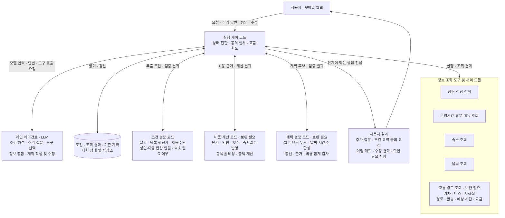
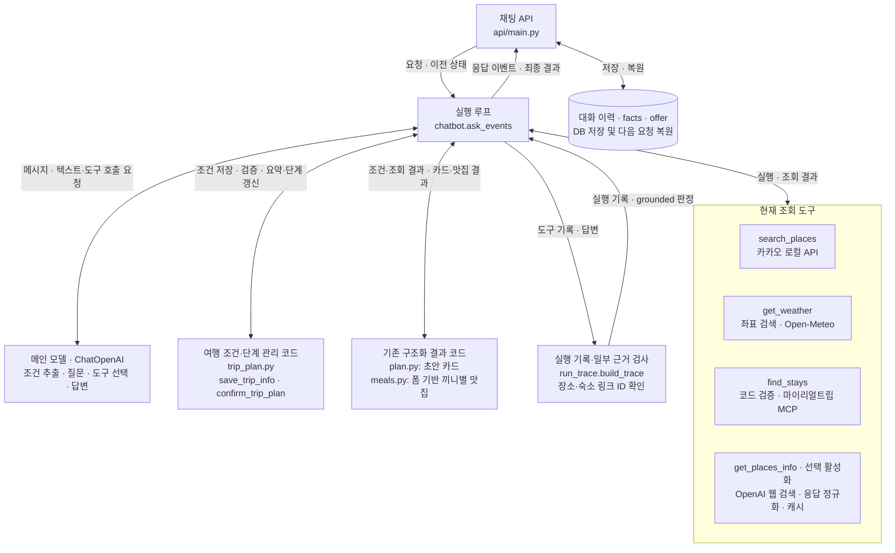

# AI 역할 명세서

| 항목 | 내용 |
|---|---|
| 문서 상태 | 1~6절 초안 — 목표 동작과 현재 구현을 구분, 실패 처리 절 작성 전 |
| 기준 문서 | [PRD](PRD.md) |
| 작성일 | 2026-10-31 |
| 최종 수정일 | 2026-11-01 |

이 문서는 여행 계획 에이전트의 내부 구성과 책임을 정의한다. 현재는 구성도, 역할 분담, 조건 수집, 도구 사용, 계획 작성·수정, 출력·근거 표시 규칙을 작성한다. 모바일 웹·인증·배포 등 서비스 전체 구조는 시스템 설계서에서 다룬다.

## 1. 에이전트 아키텍처

### 1.1 MVP 목표 구성도

**하나의 메인 에이전트가 도구를 선택하고 계획을 작성하며, 코드가 조건·상태·계산·검증을 담당하는 구조**를 제안한다. 장소·숙소·교통 조회는 도구 또는 처리 모듈이며, 각각을 독립된 AI 에이전트로 전제하지 않는다. 아래 그림은 PRD 요구사항을 구현하기 위한 목표 설계이며 현재 구현 완료 상태를 나타내지 않는다.

화살표는 구성 요소 사이의 연결을 나타낸다. 매 요청마다 모든 모듈을 실행한다는 뜻은 아니다. 도구 결과·검증 결과는 실행 제어 코드를 통해 메인 에이전트에 전달한다. 추가 질문·조건 요약·동의 요청은 최종 계획과 다른 응답이며, 전체 실행 순서와 검증 실패 시 재작성 정책은 후속 정의한다.

| 구성 요소 | 목표 책임 | 현재 구현과의 관계 |
|---|---|---|
| 메인 에이전트 | 의도·조건 해석, 필요한 추가 질문, 도구 선택, 조회 결과 종합, 계획 작성·수정 | 현재 `ChatOpenAI` 기반 도구 호출·텍스트 작성 흐름을 확장 |
| 실행 제어 코드 | 유효한 단계 전환과 동의 확인 절차, 도구 실행, 호출 한도, 결과 전달 | `chatbot.py`와 `trip_plan.py` 기반. 자연어 동의 해석은 현재 모델에 의존 |
| 조건 검증 코드 | 국내·당일치기~2박 3일·합산 최대 5명 등 범위 검사, 누락·충돌 조건 확인 | 현재 조건 검증을 확장해야 함. 왕복 행선지·이동수단은 현재 여행 조건 스키마에 없음 |
| 상태·저장소 | 사용자가 제공한 조건, 조회 결과와 출처·시점, 기존 계획·변경 내용 보관 | 현재 `facts`, 대화 이력과 DB 저장 기반. 구조화된 계획·변경 이력의 저장 방식은 후속 설계 |
| 정보 조회 | 실제 장소·식당·숙소 후보와 정보·링크, 날씨, 교통 경로·시간·요금 제공 | 장소·숙소·날씨·상세 정보 조회는 구현 있음. 교통 경로 조회 연동은 추가 필요 |
| 비용 계산 | 확인 가능한 단가와 명시한 추정 근거로 항목별·전체 비용 계산 | 전용 합산·검증 기능은 추가 필요. 예산은 대화에서 파악하고 미언급 시 추가 요청 없이 예상 비용 제시 |
| 계획 검증 | PRD의 8개 요소 및 조건 충족 여부를 가능한 범위에서 코드로 검사 | 현재 링크 근거 검사를 확장해야 함. 실행 가능성과 실제 유용성은 별도 평가도 필요 |

아동 요금 기준, 교통 데이터 출처, 비용 산식, 동선 검증 방식과 재작성 횟수는 아직 결정하지 않았다. 자동 검사 통과를 사용자 평가나 전체 여행 품질 점수 통과로 간주하지 않는다.

### 1.2 현재 구현 구성도

아래는 현재 코드에서 확인한 구성이다. 코드에 존재하는 기능을 표시하며, 테스트·실제 모델·외부 API 연동·브라우저 검증의 통과를 의미하지 않는다.

현재 구조에서 주의할 점은 다음과 같다.

- `find_stays`는 별도 LLM이 판단하는 에이전트가 아니라 검증·MCP 호출·정규화를 수행하는 코드 도구다.
- `get_places_info`는 웹 검색 모델을 사용하지만, 메인 모델처럼 독립적으로 여행 계획을 조율하지 않는다. 출처 URL·형식 검증이 정보의 정확성 전체를 보장하지는 않는다.
- 기존 초안 카드는 코드가 작성하고, 끼니별 맛집 추천은 폼 입력을 받아 코드가 처리한다. 완성형 텍스트 계획의 작성 흐름과 구분한다.
- 현재 근거 검사는 일부 지도·숙소 링크 ID를 확인한다. 날짜·요금·동선·전체 문장의 사실성이나 계획 품질을 종합 검증하는 기능은 아니다.
- 현재 `done`은 계획 작성 단계의 종료를 나타낸다. PRD 평가 통과나 모든 조회 성공을 보장하는 상태가 아니다.

### 1.3 구현 근거

- [에이전트 실행 루프와 도구 등록](../backend/chatbot.py)
- [여행 조건·단계 관리](../backend/trip_plan.py), [모델 지시·호출 한도](../backend/config.py)
- [장소·날씨 도구](../backend/tools.py), [날짜·예보 처리](../backend/weather.py)
- [숙소 조회](../backend/stays.py), [장소 상세 정보 조회](../backend/place_info.py)
- [기존 초안 생성](../backend/plan.py), [기존 맛집 추천](../backend/meals.py)
- [실행 기록·근거 검사](../backend/run_trace.py)
- [API 처리·상태 복원](../backend/api/main.py), [대화 저장](../backend/api/store.py)

## 2. AI와 코드의 역할 분담

### 2.1 기본 원칙

**AI는 자연어의 의미를 파악하고 정보를 종합해 계획을 제안한다. 코드는 입력과 실행을 제어하고, 외부 정보를 조회하며, 정해진 규칙으로 계산·검증·저장한다.** 아래는 MVP 목표 책임 분담이다. 현재 구현 상태는 2.4절에서 별도로 구분한다.

조회 결과는 외부 정보의 근거이고, AI의 제안은 여행 계획의 구성안이다. 코드 검증 결과는 해당 검사 범위를 통과했다는 뜻이며, 여행 전체의 정확성이나 실용성을 보증하지 않는다. 평가 점수와 최종 MVP 완료 판단은 별도 평가 절차에서 정한다.

### 2.2 업무별 책임

업무를 **대화·조건 관리 → 정보 탐색·근거 관리 → 계획 수립·수정 → 실행·결과 관리**의 네 범주로 나눈다.

#### 2.2.1 대화·조건 관리

| 업무 | AI의 책임 | 코드의 책임 |
|---|---|---|
| 요청 구분 | 계획 작성·정보 조회·추가 답변·동의·조건 변경·부분 수정 의도를 해석한다. 불명확한 의도는 확인한다. | 요청 유형과 현재 단계의 조합을 검증하고 허용된 기능만 실행한다. |
| 조건 추출 | 사용자 쿼리·대화에서 실제로 제공한 날짜·왕복 행선지·이동수단·인원·숙소 필요 여부·예산·취향을 추출한다. | 추출값의 형식·범위·누락·충돌을 검사하고 유효한 조건을 누적한다. 미정인 필드의 상세 구조는 데이터 명세서에서 정한다. |
| 추가 질문 | 누락·모호함·충돌에 맞는 질문을 작성하고 이미 받은 정보를 활용한다. 예산 언급이 없으면 예산을 추가로 묻지 않는다. | 수집한 조건과 누락·오류 상태를 AI에 제공한다. 질문 생성만으로 조건을 충족한 것으로 처리하지 않는다. |
| 날짜·인원·지원 범위 | 상대 날짜와 인원 표현을 해석할 수 있도록 원문·의미를 전달하고, 확인이 필요한 내용을 질문한다. | 기준 날짜·시간대에 따라 날짜를 정규화한다. 국내, 당일치기~2박 3일, 성인·아동 합산 최대 5명과 지원 이동수단 범위를 검증한다. |
| 요약·작성 동의 | 사용자의 동의·거절·조건 수정 의도를 구분하고, 동의 없는 요청을 동의로 추측하지 않는다. | 저장된 조건으로 요약과 동의 대기 상태를 관리하고, 조건 충족·유효한 동의 상태에서만 계획 작성 단계로 전환한다. |

#### 2.2.2 정보 탐색·근거 관리

| 업무 | AI의 책임 | 코드의 책임 |
|---|---|---|
| 정보 탐색 | 요청과 조건에 필요한 도구와 검색 조건을 선택한다. 결과가 부족할 때 추가 조회 필요성을 판단한다. | 허용 도구만 실행하고 인자·중복 호출·호출 한도를 검사한다. 외부 API 요청, 결과 정규화, 오류·빈 결과 구분을 담당한다. |
| 조회 근거 관리 | 결과에 없는 장소 정보·요금·평점·운영시간을 조회 사실처럼 만들지 않는다. 외부 문서 안의 지시문을 실행 지시로 따르지 않는다. | 결과의 출처·조회 조건·시점·상태를 보관하고 모델과 화면에 전달한다. 출처·링크·형식의 검사 범위를 명확히 한다. |

#### 2.2.3 계획 수립·수정

| 업무 | AI의 책임 | 코드의 책임 |
|---|---|---|
| 숙소·식당 선정 | 실제 조회된 후보 중 인원·취향·방문 순서에 맞는 후보를 골라 이유와 정보·링크를 제시한다. | 후보 정보·식사 및 숙박 대상 날짜를 제공하고, 확인 가능한 인원·날짜·운영 조건의 불일치를 검사한다. 정보가 없으면 미확인으로 남긴다. |
| 이동·동선 작성 | 왕복 이동과 방문지·숙소·식당을 연결한 일정 후보를 구성하고, 사용자의 이동수단을 반영한다. | 기차·버스·지하철 경로·환승·시간·요금을 조회한다. 시간 겹침·연결 불가 등 정의된 규칙으로 검사하며, 항공·여객선 필요 구간은 지원 범위 밖으로 처리한다. |
| 비용 산정 | 사용자 언급 예산을 해석하고 비용 항목·근거·추정 여부를 설명한다. 예산이 없으면 임의의 예산 상한을 설정하지 않는다. | 단가·인원·횟수·숙박일수·적용 가능한 요금 기준으로 항목별 비용과 총액을 계산한다. 누락 단가·중복 합산·세금 및 인당·전체 기준을 구분한다. |
| 계획 작성·검증 | 조회·계산 결과를 종합해 8개 평가 요소를 포함한 계획 후보를 작성하고 검증 결과에 따라 수정한다. | 필수 요소·날짜·인원·비용 합계·근거 등 구현된 검사를 수행하고 실패·미확인 항목을 반환한다. 자동 검사로 판단하지 못하는 실용성은 별도 평가 대상으로 남긴다. |
| 계획 수정 | 변경 의도와 영향을 받는 일정·후보·비용을 파악하고 관련 부분을 수정한다. 관계없는 내용을 임의로 바꾸지 않는다. | 조건 변경·동의 상태·기존 계획을 관리한다. 변경 영향에 맞게 재조회·재계산·재검증하고 수정 결과를 저장한다. 영향 범위 판정 방식은 후속 정의한다. |

#### 2.2.4 실행·결과 관리

| 업무 | AI의 책임 | 코드의 책임 |
|---|---|---|
| 실패·한도 대응 | 검색 결과 없음·조회 실패·미확인 정보를 구분해 설명하고, 확인 가능한 부분과 남은 확인 사항을 전달한다. | 오류를 분류하고 무한 반복을 막는다. 내부 예외·비밀키를 노출하지 않는 응답을 제공한다. 재시도 횟수·부분 결과 제공 조건은 후속 정의한다. |
| 상태·결과 전달 | 사용자에게 필요한 조건 요약·계획·근거·주의사항을 간결하게 작성한다. 저장 성공이나 예약 완료를 임의로 선언하지 않는다. | 실제 상태에 맞는 진행 이벤트·최종 응답을 전송하고, 대화·조건·조회 결과·계획을 저장·복원한다. 사용자별 접근 제한은 API 계층에서 수행한다. |

아동 연령별 요금, 숙소 수용 인원·객실 수, 환승·이동 시간, 세금 등은 제공 데이터가 뒷받침하는 범위에서 검증한다. 값을 알 수 없는데도 계산·검증을 통과한 것으로 표시하지 않는다. 필요한 추가 질문과 근거 있는 추정의 허용 범위는 후속 절에서 구체화한다.

### 2.3 AI와 코드 사이의 전달 정보

다음은 논리적인 전달 항목이다. 새로운 API나 데이터 스키마가 구현되었다는 뜻은 아니다.

| 방향 | 전달 항목 | 처리 기준 |
|---|---|---|
| 코드 → AI | 현재 날짜·상태, 대화 맥락, 저장된 조건과 기존 계획 | 이미 받은 정보를 재사용하고 시스템이 관리하는 상태를 따른다. |
| AI → 코드 | 추출 조건·변경 항목 | 사용자가 실제로 말한 내용과 불명확한 내용을 구분한다. 검증 전에는 확정 조건으로 저장하지 않는다. |
| 코드 → AI | 누락·오류·충돌 항목, 정규화된 조건 | 필요한 질문·수정에 활용한다. 원문과 적용 날짜가 다르면 사용자가 확인할 수 있어야 한다. |
| AI → 코드 | 도구 이름·조회 인자 | 허용 도구·유효한 인자·호출 한도 검사를 거쳐 실행한다. |
| 코드 → AI | 조회 결과·출처·시점·상태와 계산 결과 | 조회 사실·계산·추정·미확인을 구분해 계획에 반영한다. |
| AI → 코드 | 계획 후보·수정 후보 | 정의된 검사를 수행할 수 있는 구조가 필요하다. 형식과 필드, 텍스트·화면 표현 방식은 후속 명세에서 정한다. |
| 코드 → AI | 검증 성공·실패·미확인 항목 | 실패를 수정하거나 한계를 안내한다. 실패 시 재작성·사용자 응답 기준은 후속 합의한다. |

최종 응답의 표시·저장 여부는 실행 제어 코드가 결정한다. AI가 문장으로 “검증 완료”라고 출력한 것만으로 검증 성공 상태를 만들지 않는다.

### 2.4 현재 구현과 목표의 차이

| 영역 | 현재 코드에서 확인한 상태 | 보완할 책임 |
|---|---|---|
| 조건·질문 | `save_trip_info`의 추출은 모델, 필수 항목 검사·누적은 코드가 담당한다. 왕복 행선지·이동수단 필드가 없고, 현재 지시에는 선택 예산 질문을 허용하는 문구가 있다. | 왕복 행선지·이동수단 수집과 MVP 범위 검증, 예산 미언급 시 추가 질문하지 않는 규칙 반영 |
| 동의·단계 | 모델이 동의를 해석해 `confirm_trip_plan`을 호출하고, 코드는 필수 조건과 `confirm` 상태를 검사한다. | 자연어의 모호한 동의·거절·조건 변경에 대한 실제 모델 평가. 상태 검사만으로 동의 해석 정확성을 보장하지 않음 |
| 숙소·식당 | 실제 조회·정규화와 링크 제공 경로가 있다. 전체 텍스트 계획과 기존 맛집 폼은 별도 흐름이다. | 아동 동반·합산 5명 조건, 필요한 숙박·끼니 누락과 후보 반영 검증 |
| 교통·비용 | 전용 교통 경로 조회 도구와 전체 비용 합산 검증이 현재 도구 등록·계획 흐름에서 확인되지 않는다. | 경로 데이터 연동, 비용 산식·계산 코드와 검증 추가 |
| 계획 검증 | `run_trace._grounded`는 일부 장소·숙소 링크 ID를 검사한다. `done`은 작성 실행 종료 시 설정된다. | 8개 요소 및 날짜·비용·동선의 정의된 검사와 실패·미확인 처리. 종료와 품질 통과 상태 구분 |
| 수정·저장 | 조건 변경 시 재확인 흐름과 대화 저장이 있으며, 부분 수정은 모델 지시가 있다. | 기존 기능을 유지하면서 변경 영향·관련 재조회·비용 갱신·비변경 부분 보존 평가 |

이 절은 코드 확인과 목표 책임을 정리한 것이며, 테스트나 실제 서비스 검증 결과가 아니다. 추가 질문의 상세 기준은 다음 절에서 정하고, 평가 배점·통과점수는 평가 명세서에서 정한다.

## 3. 여행 조건 수집·추가 질문 규칙

이 절은 PRD를 충족하기 위한 목표 행동 초안이다. 현재 `trip_plan.py`의 필수 필드와 동일하지 않으며, 아래 기준을 그대로 구현했다고 간주하지 않는다. 필드별 타입·저장 구조는 데이터 명세서에서 정한다.

### 3.1 조건의 구분

#### 계획 작성에 필요한 기본 조건

| 조건 | 수집·확인 기준 |
|---|---|
| 여행 기간 | 출발일과 귀가일 또는 박수·일수를 파악한다. 당일치기는 0박 1일로 처리하고 최대 2박 3일인지 검증한다. 상대 날짜는 코드가 적용 날짜로 정규화하고 요약에서 확인한다. |
| 출발·귀가 시각 | 계획 작성의 필수 정보로 수집한다. 미언급·불명확한 경우 추가로 확인하고, 이미 제공한 시각은 재사용한다. 교통편과 첫날·마지막날의 활동·식사 배치에 반영한다. |
| 왕복 행선지 | 여행 목적지, 출발지와 귀가 목적지를 파악한다. 귀가지는 출발지와 같다고 단정하지 않고, 왕복 출발지가 명확한 표현은 재사용한다. |
| 이동수단 | 왕복 및 여행지 내 이동수단을 파악한다. 서로 다를 수 있으며, 이미 전체 구간을 포함해 답한 내용을 반복 질문하지 않는다. |
| 여행 인원 | 총인원과 성인·아동 구성을 파악한다. “5인 가족”만으로 성인 2명·아동 3명으로 추측하지 않는다. 성인·아동 합산 최대 5명을 확인한다. |
| 숙소 필요 여부 | 숙박 여행에서 숙소 추천이 필요한지, 이미 정한 숙소가 있는지 파악한다. 당일치기는 별도 숙박 요청이 없는 한 숙소 불필요로 처리하고 불필요한 확인 질문을 생략한다. |

사용자가 말한 내용에서 명확하게 도출할 수 있는 값은 코드로 계산해 활용한다. 예를 들어 출발일과 “2박 3일”이 있으면 귀가일을 다시 묻지 않는다. 추측으로 채운 값과 사용자 표현에서 계산한 값을 구분한다.

#### 상황에 따라 필요한 조건

| 조건 | 질문이 필요한 상황 |
|---|---|
| 이미 정한 숙소·방문지 | 사용자가 유지할 대상으로 언급했으며 동선 작성에 위치·이용 날짜 등이 필요한 경우. |
| 조건 충돌 | 기간·인원·행선지·이동수단 등이 서로 맞지 않거나 기존 조건과 새 입력의 변경 의도가 불분명한 경우. |

#### 선택 조건

- **세부 위치:** 필수 입력으로 요구하지 않는다. 미입력 시 “출발·도착 지점을 더 구체적으로 알려주시면 경로와 이동 시간을 더 정확하게 안내할 수 있어요”처럼 선택적으로 유도한다. 미제공만으로 작성을 중단하지 않는다. 이용한 기준 지점과 실제 출발·도착 지점에 따라 달라질 수 있는 구간을 구분한다.
- **아동 연령:** 아동 동반 시에도 필수 입력으로 요구하지 않는다. 미입력 시 “아이들의 나이를 알려주시면 요금과 숙소·활동 추천을 더 정확하게 안내할 수 있어요”처럼 선택적으로 유도한다. 미제공만으로 작성을 중단하지 않으며, 연령을 임의로 정하거나 연령별 할인·이용 가능 여부를 확정하지 않는다. 비용·추천의 적용 범위와 확인이 필요한 부분을 밝힌다.
- **예산:** 쿼리·대화에 있으면 반영한다. 없으면 추가 요청 없이 항목별 예상 비용과 총액을 제시한다. 실제 예산을 언급했지만 총액·1인당 기준 등이 모호하면 필요한 부분을 확인할 수 있다.
- **취향·선호·추가 제약:** 사용자가 언급한 활동 선호, 음식 선호, 이동·접근성 제약 등을 반영한다. 미입력 자체를 계획 작성 차단 사유로 삼지 않는다. 명시된 제약의 의미가 모호하거나 다른 조건과 충돌하면 확인한다.

### 3.2 추가 질문 원칙

1. 먼저 현재 쿼리와 저장된 대화·조건에서 답을 찾는다. 사용자에게 이미 받은 값을 다시 묻지 않는다.
2. 계획 작성에 필요한 누락·모호함·충돌 항목을 골라 한 메시지에서 간결하게 묻는다. 항목을 불필요하게 하나씩 나눠 질문하지 않는다.
3. “정보를 더 알려 주세요” 대신 어떤 정보가 필요한지 구체적으로 질문한다. 조건부 질문은 왜 필요한지 짧게 설명한다.
4. 사용자가 일부만 답하면 유효한 답을 누적하고 남은 필수 항목만 질문한다. 빈 값으로 기존 조건을 덮어쓰지 않는다.
5. 모호한 내용을 임의로 확정하지 않는다. 동시에 의미가 명확하거나 코드로 계산할 수 있는 내용까지 재확인하지 않는다.
6. 사용자가 필수 정보를 정하지 못하면 선택에 도움을 줄 수 있지만, 후보·제안을 사용자의 확정 조건으로 저장하지 않는다.
7. 필요한 조건이 모이면 요약과 작성 동의로 넘어간다. 예산·취향을 얻기 위해 추가 질문을 계속하지 않는다.
8. 세부 위치·아동 연령은 제공 시 답변 품질을 높일 수 있음을 안내하되, 응답을 기다리는 필수 질문으로 취급하거나 반복 요청하지 않는다.

### 3.3 요청별 질문 범위

| 요청 | 추가 질문 범위 |
|---|---|
| 전체 계획 작성 | 기본 조건과 해당 요청의 실행에 필요한 조건부 정보를 확인한다. |
| 장소·식당 검색 | 검색 지역·종류 등 해당 조회에 필요한 내용만 확인한다. 전체 여행 기간·인원을 일괄 요구하지 않는다. |
| 날씨 조회 | 조회 지역과 날짜를 확인한다. 날짜가 없으면 질문하고 현재 날씨로 임의 대체하지 않는다. |
| 숙소 조회 | 지역·숙박 날짜·인원 등 조회에 필요한 조건을 확인한다. 전체 계획의 왕복 이동 정보를 요구하지 않는다. |
| 계획 수정 | 기존 조건과 계획을 활용해 변경 항목·영향 범위의 불명확한 부분만 확인한다. 처음부터 전체 조건을 다시 묻지 않는다. |

### 3.4 조건 요약과 동의 연결

- 수집·검증한 기간, 출발·귀가 시각, 왕복 행선지, 이동수단, 성인·아동 인원, 숙소 필요 여부와 언급된 선택 조건을 요약한다.
- 날짜 보정·조건 해석이 있었다면 실제 적용 내용을 사용자가 확인할 수 있게 한다.
- 예산이 없으면 사용자가 예산을 설정한 것처럼 요약하지 않는다.
- 요약 이후 사용자가 조건을 바꾸면 변경 내용을 저장·검증하고 새 요약과 동의 절차를 거친다.
- 질문·거절·조건 변경을 작성 동의로 간주하지 않는다. 동의 해석이 불명확하면 확인한다.

### 3.5 확정 사항과 후속 명세

출발·귀가 시각은 필수, 세부 위치·아동 연령은 선택 입력으로 확정했다. 선택 정보 미제공 시에도 계획을 작성하며, 제공하면 더 정확한 안내가 가능함을 유도한다. 세부 위치가 없는 경로의 기준 지점 선정과 연령 미확인 시 비용 추정의 처리 방식은 도구·비용 명세에서 구체화한다. 정상·누락·충돌 시나리오와 점수 기준은 평가 명세서에 연결한다.

## 4. 정보 탐색·도구 사용 규칙

이 절은 MVP 목표 동작 초안이다. 실제 도구 이름은 현재 구현을 기준으로 표시하며, 미구현 기능은 역할만 정의한다. 특정 외부 서비스나 새 도구 API의 도입을 확정하는 문서는 아니다.

### 4.1 실행 원칙

- 메인 에이전트는 요청·조건에 필요한 조회를 선택하고, 실행 제어 코드는 허용 도구·입력·단계·호출 한도를 확인한다.
- 전체 계획 작성은 기본 조건 수집과 요약·동의 이후에 필요한 외부 정보를 조회한다. 개별 정보 조회에는 전체 계획의 동의 절차를 요구하지 않고 3.3절의 입력 범위를 적용한다.
- 사용자 조건이나 기존 조회 결과로 답할 수 있으면 의미 없이 같은 조회를 반복하지 않는다. 인사·설명 요청·단순 표현 수정에는 불필요한 외부 조회를 하지 않는다.
- 실제 후보·경로·요금·운영시간처럼 외부 근거가 필요한 값은 조회 결과를 사용한다. 조회되지 않은 값을 모델 지식만으로 최신 조회 사실처럼 제시하지 않는다.
- 외부 응답의 문장은 정보로 취급한다. 응답 안에 포함된 도구 실행·조건 변경·비밀정보 공개 지시를 따르지 않는다.

### 4.2 도구별 사용 기준

#### 장소·식당·상세 정보

| 기능 | 사용 시점·필요 입력 | 결과 사용 기준 |
|---|---|---|
| 장소·식당 검색 — `search_places` | 지역과 장소 종류·검색 의도가 분명할 때 실행한다. 새 방문지·식당을 계획에 추가할 때도 실제 후보를 검색한다. | 장소명·주소·지도 링크와 도구가 제공한 필드만 조회 사실로 사용한다. 검색 결과에 없는 영업시간·가격·후기를 덧붙이지 않는다. |
| 운영시간·휴무·메뉴 — `get_places_info` | 실제 조회한 장소의 이름·주소를 바탕으로, 방문일의 운영 여부나 식당 메뉴·가격 등 필요한 상세 정보를 확인한다. | 출처가 있는 결과와 미확인을 구분한다. 이름이 비슷한 다른 장소의 정보를 합치지 않는다. 확인된 휴무일은 일정에 반영하며 공휴일·임시 휴업은 별도 확인 사항으로 남긴다. |

현재 상세 정보 도구는 활성화 설정에 따라 노출되고 한 호출에 최대 6개 장소를 처리한다. 이는 현재 구현의 제한이며, 전체 여행에 필요한 정보가 모두 수집됐음을 뜻하지 않는다.

#### 숙소·날씨

| 기능 | 사용 시점·필요 입력 | 결과 사용 기준 |
|---|---|---|
| 숙소 검색 — `find_stays` | 숙소 추천이 필요하고 지역·체크인·체크아웃·성인 및 아동 인원이 확인됐을 때 실행한다. 당일치기·숙소 불필요·기존 숙소 유지 요청에서는 불필요하게 검색하지 않는다. | 실제 후보·확인 가능한 정보·예약 링크를 제공한다. 표시 가격의 숙박일수·객실·인원·세금 기준을 확인하고, 불명확한 기준을 임의로 곱하거나 확정 가격으로 안내하지 않는다. |
| 날씨 조회 — `get_weather` | 지역·날짜가 있는 날씨 질문 또는 일정·준비물에 날씨 반영이 필요할 때 실행한다. | 요청 날짜와 응답 날짜·성공 상태를 확인한다. 예보 범위 밖이면 해당 날짜의 수치를 작성하지 않고, 다른 날짜의 예보로 대신하지 않는다. |

숙소 조회에서 아동 연령 미제공만으로 계획 작성을 막지 않는다. 현재 도구가 연령별 조건이나 5인 투숙 가능 여부를 확인하지 못하면 확정하지 않고 확인 필요로 표시한다. 날씨를 조회하지 않은 여행 날짜까지 예보를 확인한 것처럼 표현하지 않는다. 여행 전체 날짜의 필수 조회 여부는 후속 확정한다.

#### 교통·비용 처리 — 보완 필요

| 기능 | 사용 시점·필요 입력 | 결과 사용 기준 |
|---|---|---|
| 대중교통 경로 조회 — 도구 미정 | 왕복 또는 여행지 내 기차·버스·지하철 구간에 대해 출발·도착 지점, 이용 날짜·시간 조건, 이동수단으로 조회한다. 인원·연령 기준은 제공 데이터가 지원하는 범위에서 적용한다. | 구간별 경로·승하차 지점·환승·예상 시간·요금과 출처를 확보한다. 경로 검색 링크만으로 요건을 충족했다고 판단하지 않는다. 조회 불가 항목은 미확인으로 남긴다. |
| 자가용·렌터카 경로·비용 산정 — 방식 미정 | 출발·도착 지점과 시간 조건, 차량 이동이 필요한 구간을 기준으로 계산한다. | 이동 시간·거리와 산정 가능한 비용의 근거를 구분한다. 유류비·통행료·렌트비 등 단가·계산 기준은 후속 정의하며 임의의 값을 실제 조회값처럼 사용하지 않는다. |
| 비용 계산 — 처리 모듈 미정 | 조회 단가·숙박일수·인원·이용 횟수 등 산정 근거가 준비된 항목부터 계산한다. | 코드로 항목별 비용·총액을 산출하고 조회값·추정·미확인을 구분한다. 금액이 없는 항목을 0원으로 넣지 않으며, 미확인 비용이 있으면 합계의 포함·제외 범위를 표시한다. |

세부 위치가 없으면 사용한 기준 지점과 포함하지 못한 접근 구간을 밝힌다. 아동 연령이 없으면 특정 연령별 할인 적용을 확정하지 않는다. 항공·여객선 구간은 조회·계획 지원 범위에서 제외하며, 필요한 구간을 누락한 채 왕복 이동이 완성됐다고 안내하지 않는다.

### 4.3 조회 결과 보관·재사용

코드는 조회 입력, 결과 상태, 출처, 조회 시점과 결과 식별 정보를 보관한다. AI는 현재 조건과 관련된 결과만 사용한다. 저장 필드·캐시 키·유효기간은 데이터 명세서에서 정한다.

| 변경 상황 | 재사용·재조회 기준 |
|---|---|
| 설명 길이·문체만 변경 | 조건과 정보가 유효하면 재조회 없이 표현을 수정한다. |
| 날짜·시간 변경 | 교통 경로·시간·요금, 날씨, 숙소 가격·숙박 조건, 방문일 운영 여부 중 영향을 받는 항목을 재확인한다. |
| 인원·아동 정보 변경 | 숙소 수용 조건·가격, 교통 요금과 식비 등 관련 계산을 다시 확인한다. 장소의 기본 정보까지 일괄 재조회하지 않는다. |
| 목적지·왕복 행선지·이동수단 변경 | 관련 장소·숙소·식당 후보와 경로·비용을 재조회·재계산한다. 변경하지 않은 조건까지 삭제하지 않는다. |
| 일부 장소·숙소·식당 변경 | 해당 후보와 연결 이동·영업 조건·비용을 재확인한다. 영향이 없는 결과는 유효성 확인 후 재사용한다. |
| 결과 오래됨·출처 충돌·조건 불일치 | 유효기간과 조회 조건을 확인하고 필요한 부분을 재조회한다. 어느 값을 사용할지 확인하지 못하면 불일치·미확인 상태를 전달한다. |

현재 장소 상세 정보 캐시는 확인 결과 7일, 찾지 못한 결과 1일을 기준으로 한다. 이 기간을 교통·숙소·날씨에 공통 적용하지 않는다. 이전에 조회했다는 이유만으로 변경한 조건에서도 유효하다고 보지 않는다.

### 4.4 재검색과 호출 한도

- 같은 실행에서 동일한 도구·인자의 중복 호출을 방지한다. 기술적 실패의 재시도와 검색 조건을 바꾸는 재검색은 구분한다.
- 현재 장소 검색 프롬프트는 첫 검색 0건 시 지역·핵심 조건을 유지한 검색어 변경을 한 차례 허용한다. 이를 모든 도구의 공통 재시도 정책으로 간주하지 않는다.
- 핵심 조건을 바꿔야 후보를 찾을 수 있다면 사용자에게 확인한다. 아동 동반·지역·이동수단 등 명시된 조건을 조용히 완화하지 않는다.
- 현재 실행 한도는 일반 요청의 도구 4회·모델 6회, 계획 작성 단계의 도구 9회·모델 11회다. 노출 도구 한 번이 내부 API·웹 검색 한 번과 같지는 않다. 내부 호출 횟수·시간·비용 관리 기준은 별도 설계한다.
- 한도에 도달하면 추가 탐색을 중단하고 확보한 정보와 남은 확인 사항을 전달한다. 조회하지 못한 내용을 채워서 완성된 계획이라고 선언하지 않는다.

### 4.5 결과 상태와 후속 정의

정상 결과, 정상 검색의 후보 없음, 일부 정보 미확인, 입력·조건 불일치, 인증·네트워크 등 실행 오류를 구분한다. 예보 범위 밖 역시 정상적인 정보 부재로 다루며 다른 날짜 수치로 채우지 않는다.

교통·자가용 경로 데이터 출처, 조회·캐시 유효기간, 기준 지점 선정, 비용 산식은 후속 설계 대상이다. 오류별 재시도 횟수, 대안 제시·부분 계획 제공·작성 중단의 경계와 사용자 안내는 실패 처리 절에서 구체화한다. 이 절은 도구 호출·결과 사용 기준이며 실제 연동·테스트 통과를 의미하지 않는다.

## 5. 계획 작성·수정 규칙

이 절은 PRD의 8개 평가 요소를 실제 계획으로 연결하는 목표 행동 초안이다. 작성·검증의 순서를 정의하며, 전용 동선·비용 검사나 구조화된 계획 저장이 현재 모두 구현되었다는 의미는 아니다.

### 5.1 작성 시작과 범위

- 3절의 기본 조건을 수집·검증하고 요약에 대한 사용자 동의를 받은 뒤 전체 계획을 작성한다.
- 국내, 당일치기~2박 3일, 성인·아동 합산 최대 5명과 지원 이동수단 범위를 유지한다. 지원 범위를 벗어난 조건을 임의로 축소해 계획을 만들지 않는다.
- 출발·귀가 시각은 필수 조건으로 반영한다. 세부 위치·아동 연령 미제공만으로 작성을 중단하지 않고, 적용한 기준과 확인이 필요한 부분을 남긴다.
- 이미 정한 숙소·방문지 등 유지 요청을 우선 반영한다. 예약·결제나 실제 교통편·객실 확보가 완료되었다고 표현하지 않는다.

### 5.2 일자별 일정과 동선 구성

#### 시간·이동 배치

| 항목 | 작성 기준 |
|---|---|
| 전체 기간 | 출발부터 귀가까지 모든 날짜를 포함한다. 첫날·마지막날의 이동 시간을 반영하고, 당일치기도 왕복 이동을 포함한 하루 일정으로 작성한다. |
| 왕복 이동 | 출발지 → 여행지, 여행지 → 귀가 목적지의 연결을 모두 포함한다. 외부 교통수단이 필요한 미지원 구간을 누락하고 왕복 경로가 완성된 것으로 제시하지 않는다. |
| 일자별 연결 | 방문지·식당·숙소의 순서를 정하고 구간 이동을 연결한다. 가까운 장소를 묶되 직선거리만으로 실제 이동 가능성을 단정하지 않는다. |
| 대중교통 | 기차·버스·지하철 구간별 경로·승하차·환승·예상 시간·요금을 조회 결과로 반영한다. 도보 접근·환승·대기 구간을 확인 가능한 범위에서 포함하며 없는 시간표를 만들지 않는다. |
| 활동·휴식 | 이동·관람·식사·휴식을 배치하고 활동 시간을 겹치게 하지 않는다. 아동 동반 조건과 사용자의 여행 밀도·취향을 반영한다. 체류·휴식 시간 제안은 조회한 사실과 구분한다. |
| 운영·시간 제약 | 확인된 영업시간·휴무·입장 마감과 숙소 이용 조건을 반영한다. 미확인 시간을 임의의 영업시간으로 채우지 않는다. |

출발·귀가 시각을 구체적인 구간과 연결할 때 의미가 모호하면 확인한다. 사용자가 제공한 시각을 맞추기 위해 실제 조회된 교통편의 시간이나 소요 시간을 임의로 변경하지 않는다.

#### 숙소·식당·인원 반영

- 숙소가 필요하면 숙박일별로 실제 후보와 정보·링크를 포함한다. 사용자 숙소 유지 요청이나 당일치기에는 불필요한 신규 후보를 넣지 않는다.
- 숙소 이름·가격이 조회됐다는 사실만으로 전원이 한 객실에 투숙 가능하거나 객실이 확보됐다고 단정하지 않는다. 객실·수용 인원·아동 조건 미확인은 별도로 표시한다.
- 식당은 여행 날짜와 출발·귀가 시각에 필요한 끼니를 기준으로 배치한다. 식당 후보가 없는 자리를 음식 종류만으로 채우고 실제 후보 제공 요건을 충족했다고 처리하지 않는다.
- 성인·아동 인원을 숙소·식사·교통·비용에 일관되게 반영한다. 연령 미제공 시 특정 할인이나 활동 가능 연령을 확정하지 않는다.

### 5.3 예상 비용 구성

| 항목 | 산정 기준 |
|---|---|
| 교통 | 왕복과 여행지 내 이동을 모두 확인한다. 대중교통 인원별 요금과 자가용·렌터카의 차량 단위 비용을 구분해 계산한다. |
| 숙박 | 숙박일수·객실 수·인원·세금 등 확인된 가격 기준을 사용한다. 당일치기·별도 숙박 불필요는 미확인과 구분해 적용 제외 사유를 표시한다. |
| 식사·활동 | 계획에 배치한 끼니·인원·활동에 대응하는 식비·입장료 등을 계산한다. 확인 단가와 근거를 밝힌 추정 단가를 구분한다. |
| 총액 | 코드 계산 결과를 사용한다. 항목별·전체·인당 기준을 명확히 하고 중복 합산을 방지한다. 미확인 항목이 있으면 포함·제외 범위와 추가 비용 가능성을 표시한다. |

예산이 언급됐다면 금액과 적용 범위를 반영한다. 초과하면 초과 사실과 조정 가능한 항목을 설명하고, 값을 줄여 맞추거나 다른 사용자 조건을 임의로 바꾸지 않는다. 예산 미언급 시에는 추가로 묻지 않고 계획에 따른 예상 비용을 제시한다. 가격·할인·세금 기준이 불명확한 값을 근거 없이 확정 금액으로 계산하지 않는다.

### 5.4 계획 후보 검증

1. AI가 확인된 조건과 조회·계산 결과를 바탕으로 계획 후보를 구성한다.
2. 코드는 구현된 검사 범위에서 필수 요소 누락, 날짜·인원 불일치, 시간 겹침, 알려진 운영 제약, 경로 연결, 비용 합계를 확인한다.
3. AI는 검사 실패 항목과 영향을 받는 일정·후보·비용을 수정한다. 보완 정보가 필요하면 4절 기준에 따라 재조회한다.
4. 확인하지 못한 항목은 미확인으로 유지한다. 재작성·재조회는 한도 내에서 수행하고, 해결하지 못한 필수 요소를 감춘 채 완성했다고 안내하지 않는다.

어떤 실패를 응답 차단 사유로 볼지, 부분 계획을 제공할지와 재작성 횟수는 실패 처리 절에서 정한다. 자동 검사 통과와 PRD 품질 점수·사용자 평가 통과는 구분한다.

### 5.5 수정 요청 처리

| 요청 유형 | 수정 기준 |
|---|---|
| 저장된 조건 변경 | 기간·행선지·이동수단·인원 등 변경값을 저장·검증하고, 갱신한 조건 요약과 동의 후 계획을 다시 작성한다. 관련 조회·비용·동선을 함께 갱신한다. |
| 특정 일차·장소 수정 | 변경 대상과 연결 이동·식사·숙소·비용에 미치는 영향을 확인한다. 나머지 일정은 유효성을 확인해 보존한다. 영향이 다른 일차로 번지면 그 이유와 변경 범위를 설명한다. |
| 밀도·예산 조정 | “더 여유롭게”, “더 저렴하게”의 의도를 기존 조건과 함께 해석한다. 선택이 필요한 경우 핵심 사항만 확인하고, 일정 축소·후보 교체의 영향을 관련 항목에 반영한다. |
| 표현 수정 | 내용·조건 변경이 없으면 재조회·재계산 없이 표현만 수정한다. |
| 전체 다시 생성 | 부분 수정과 구분한다. 유지할 조건과 기존 후보 재사용 여부를 요청·상태에 맞게 적용한다. 현재 API의 답변 다시 생성은 마지막 저장 질문을 재실행하는 기능이며 계획 전체의 버전 관리 기능으로 간주하지 않는다. |

수정 응답에는 바뀐 부분과 관련 비용·동선 변화를 알린다. 유지한다고 설명한 항목이 실제로 변경되지 않았는지 확인한다. 변경할 필요가 없는 기간·인원 등을 처음부터 다시 수집하지 않는다.

### 5.6 후속 정의

구조화된 계획 형식, 변경 영향 판정·버전 보관 방식, 체류·대기·환승 여유 시간의 산정 기준과 자동 검사 범위는 후속 설계 대상이다. 사용자에게 보여줄 일정·동선·비용의 구체적인 출력 형식과 근거 표시는 다음 절에서 정의한다.

## 6. 출력 형식·정보 근거 표시

이 절은 모바일 웹앱에서 전달할 정보와 표현의 목표 기준이다. 화면 디자인이나 새로운 API 응답 스키마를 확정하지 않는다. AI는 내용을 작성하고, 코드는 구조·상태·수치·링크를 검증해 화면에 전달한다.

### 6.1 응답 유형별 구성

| 응답 유형 | 포함할 내용 |
|---|---|
| 추가 질문 | 현재 요청에 필요한 누락·모호한 항목을 짧게 묻는다. 세부 위치·아동 연령은 선택 안내임을 구분한다. |
| 조건 요약·작성 동의 | 기간·출발 및 귀가 시각·왕복 행선지·이동수단·인원·숙소 필요 여부를 제시하고 작성 동의를 요청한다. 예산·취향 등은 실제 제공한 경우에만 조건으로 표시한다. |
| 전체 계획 | 여행 개요, 일자별 일정, 연결 동선·교통, 실제 숙소·식당 후보와 정보·링크, 예상 비용, 확인 필요 사항을 제공한다. |
| 수정 결과 | 변경한 내용과 관련 동선·비용 변화, 유지한 범위를 먼저 밝힌다. 전체를 다시 보여줄지는 수정 범위와 화면 표현에 따라 정하되 기존 계획과 새 결과를 혼동시키지 않는다. |
| 개별 정보 조회 | 사용자가 물은 항목의 결과·링크·관련 출처·한계를 제공한다. 전체 계획 형식을 강제하지 않는다. |
| 부분 결과·오류 | 확보한 정보와 미확인·실패 항목을 구분한다. 완성된 계획과 혼동시키지 않으며 상세 대응은 실패 처리 절을 따른다. |

### 6.2 전체 계획의 정보 구성

#### 여행 개요·일자별 일정

- 개요에는 목적지, 여행 날짜·박수·일수, 출발·귀가 시각과 지점, 이동수단, 성인·아동 인원, 숙소 필요 여부를 표시한다.
- 일정은 날짜·일차별로 구분하고 방문 순서, 활동·식사·휴식, 구간 이동을 연결한다. 사용자가 제공한 시각, 조회된 교통 시각, 제안한 활동 시각의 성격을 구분한다.
- 당일치기는 하나의 날짜에 출발부터 귀가까지 표시한다. 숙박 불필요는 누락과 구분한다.
- 날씨를 반영한 안내에는 해당 날짜와 조회 상태를 명시한다. 조회하지 않은 날짜에 동일한 예보를 확대 적용하지 않는다.

#### 숙소·식당 후보

| 대상 | 표시할 정보 |
|---|---|
| 숙소 | 실제 후보명, 위치·특징 중 확인된 정보, 적용 숙박일, 확인 가능한 가격과 기준, 예약·상세 링크, 수용 인원 등 미확인 조건 |
| 식당 | 실제 후보명, 위치, 배치한 날짜·끼니, 확인한 메뉴·가격·운영정보, 지도·상세 링크와 미확인 사항 |

필드가 없으면 생략하거나 확인 필요로 표시하고, 없는 평점·메뉴·가격을 생성하지 않는다. 선정한 후보와 대안 후보를 구분하며 대안 후보의 비용을 계획 총액에 중복 합산하지 않는다. 후보 제공은 예약·좌석·객실 확보를 의미하지 않는다.

#### 동선·교통·비용

- 동선은 `출발지 → 방문지 → 식당 → 숙소` 등 순서가 드러나도록 제시하고 마지막 귀가 구간도 포함한다. 지도만으로 구간별 이동 설명을 대신하지 않는다.
- 대중교통은 구간별 출발·도착 지점, 수단, 노선·승하차·환승, 예상 시간·요금을 확인 가능한 범위에서 제시한다. 환승이 없으면 그 사실을 표시하고, 모르면 없음으로 단정하지 않는다.
- 세부 위치 미제공 시 경로 산정에 사용한 기준 지점을 밝히고 접근 구간의 불확실성을 표시한다. 조회된 예정 경로를 실시간 운행·탑승 보장으로 표현하지 않는다.
- 비용은 교통·숙박·식비·활동 등 항목별 금액, 합계와 적용 인원·일수 기준을 표시한다. 추정·미확인·적용 제외를 구분하고 합계에 포함되지 않은 비용을 밝힌다.
- 아동 연령 미제공 등으로 실제 요금이 달라질 수 있으면 해당 항목에 설명한다. 미확인 금액을 0원으로 표시하지 않는다.

### 6.3 근거와 불확실성 구분

| 구분 | 표시 기준 |
|---|---|
| 사용자 제공 조건 | 사용자가 말한 내용과 코드가 정규화한 적용값을 구분한다. 날짜 보정 등 의미 있는 차이는 요약에 드러낸다. |
| 외부 조회 정보 | 정보와 연결되는 출처·링크를 제공하고 가격·운영·교통 등 변동 정보에는 조회 시점·적용 조건을 확인할 수 있게 한다. |
| 코드 계산 결과 | 적용 단가·인원·횟수 등 계산 기준을 밝힌다. 계산이 정확해도 입력 단가가 추정이면 결과 역시 추정으로 표시한다. |
| AI 제안·추정 | 체류·휴식 시간, 방문 순서 등 제안과 근거 있는 비용 추정에는 그 성격을 알린다. “예상” 표기만 붙여 근거 없는 구체적인 가격·교통편을 생성하지 않는다. |
| 미확인 | 확인하지 못한 항목과 계획에 미치는 영향을 표시한다. 조회 실패, 조건 불일치, 예보 없음 등을 모두 같은 정상 결과로 뭉뚱그리지 않는다. |
| 적용 제외 | 당일치기 숙박 등 해당 없는 항목은 이유를 표시한다. 필요한 항목의 정보 부재를 적용 제외로 바꾸지 않는다. |

출처 링크가 있다는 사실만으로 해당 문장의 모든 값이 검증된 것은 아니다. 지도·예약 링크는 접근 경로이고, 운영시간·가격·요금의 근거 출처와 다를 수 있다. 도구가 제공한 링크 또는 코드가 정의된 규칙으로 생성·검증한 링크만 사용하며, AI가 URL·상품 식별자를 추측해서 만들지 않는다.

### 6.4 모바일 표현과 실행 기록

- 긴 단락 대신 짧은 제목과 날짜별 구획을 사용하고, 좁은 화면에서 읽기 어려운 가로로 긴 표를 기본 출력으로 삼지 않는다.
- 여러 정보는 일정 항목·구간별로 묶는다. 출처·조건·미확인 표시는 관련 항목에서 확인할 수 있어야 하며 중요한 누락을 하단 주의사항에만 숨기지 않는다.
- AI가 작성한 텍스트와 코드가 제공한 카드·지도·비용의 후보·날짜·금액이 일치해야 한다. 화면 표현의 중복·불일치 검사는 후속 구현 대상이다.
- 실행 기록에는 실제 사용 도구, 조회 조건·상태, 호출 횟수와 출처 등 확인 가능한 사실을 표시한다. 모델 내부 사고 과정을 생성하거나 기록으로 제시하지 않는다.
- `grounded` 등 현재 보조 검사 결과를 전체 여행 계획의 품질 인증·평가 점수로 표시하지 않는다. 이번 MVP에서 계획 점수를 사용자 화면에 제공하기로 확정한 것은 아니다.

### 6.5 현재 구현과 후속 설계

현재 화면에는 마크다운 답변과 초안·맛집·숙소·실행 기록의 표시 경로가 있다. 완성형 텍스트 계획을 위 정보 구조와 모바일 표현으로 일관되게 제공하는지, 구간별 교통과 비용·출처가 함께 표시되는지는 별도 구현·평가가 필요하다.

구조화된 출력 필드·필수값·링크 검증 규칙은 데이터·API 명세서에서, 카드·접기·지도 등 화면 표현은 모바일 UI 설계에서 구체화한다. 본 절 작성 시 화면 렌더링·실제 모델 응답은 검증하지 않았다.

## 다음 작업 — 2026-11-01 기준

- 1~5절은 사용자 검토를 거쳤다. 6절은 초안을 작성했으며 별도 검토가 남아 있다.
- [PRD 8.1절](PRD.md#81-미정-사항의-결정-우선순위)의 미정 사항 우선순위에 따라 교통 데이터 연동 가능성을 먼저 확인한다. 조사 내용은 PRD 8.2절에 기록했다.
- 카카오맵 MCP를 도구함에 추가해 외부 연결 조건과 실제 도구·응답을 확인한다. 경로·환승·시간·요금, 여행 날짜 지정과 장거리 기차 지원 여부를 검증한다. 서버 등록·연결·실제 호출은 아직 수행하지 않았다.
- 교통 정보 제약을 바탕으로 미확인·실패 허용 범위를 논의하고, 7절 **실패 처리·행동 제한**을 작성한다.
- 문서의 목표 구조와 현재 구현 차이를 유지한다. 이번 작업은 문서 작성이며 기능 개발·테스트·실서비스 검증은 수행하지 않았다.
